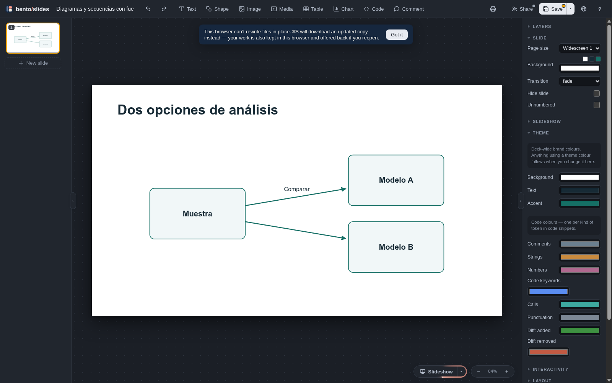
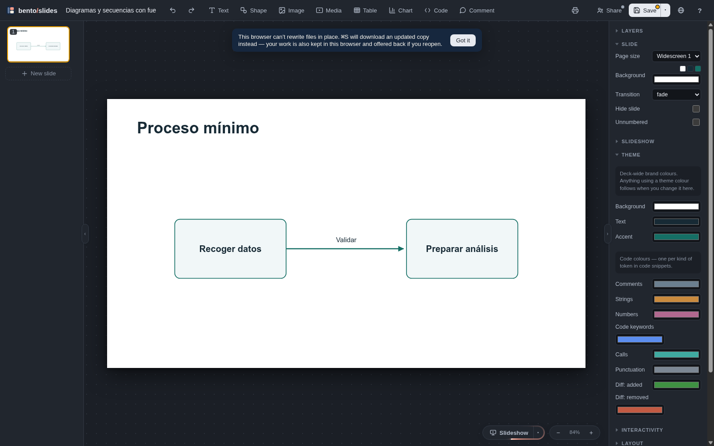
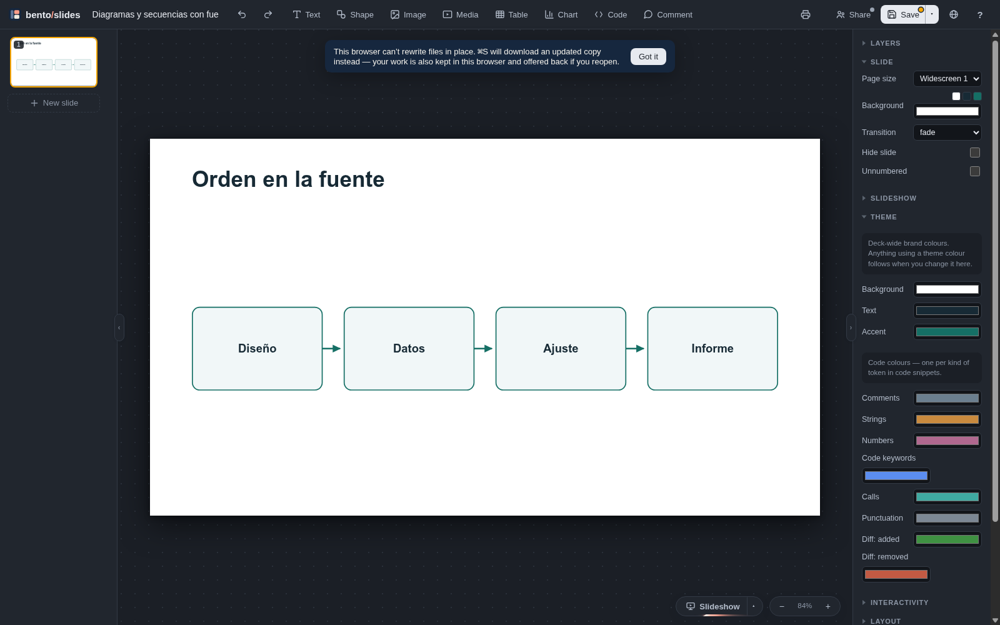

# Bounded source diagrams and timelines — Linux implementation

The source adapter reads original QMD membership and relationships before
computation. The native projection is verified against the exact original Pandoc
fragment, and shape provenance is closed to the declared graph roles and
reserved native IDs. The implemented contract and example are in
[the graph example README](../../examples/source-graphs/README.md).

Validation uses local Quarto 1.10.19, Deno 2.9.6 and Bento revision
3d6f7f1fcdf2308e875345ce4f1e0ec0820c914b (1.2.6). Typography uses an installed
Chromium headless private profile and the pinned offline shell. It measures CSS
line boxes, scroll width and DOM Range glyph extents, including saved built-in
font faces. It does not claim painted ink/effects or cross-platform equivalence.
Unsupported automatic native math/document fields and glyph overlap/anchored
overhang refuse; boxes never silently shrink text.

Focused source/state tests cover DAG/timeline membership, exact UTF-8/CRLF
endpoint patches, manipulated/stale plans, foreign/dangling endpoints,
duplicates, cycles, dynamic labels, semantic endpoint ownership, visual side
anchors, decoration isolation, pending removals and incompatible renderer
mutations. Strict composition preserves pending state and refuses native graphs
with missing parts or lost label/connector renderers. Timeline relationship
edits require explicit restoration, independent of their native z-order.

Real Quarto integration tests exercise a three-node fork and timeline, native
document Save, combined label/endpoint preview/apply and regeneration after
changed R input. They verify stable docId, updated figure content, retained
native position/fill/group state and source-authored relationship changes.
Timeline source block reorder changes derived adjacency while native z-order and
node design survive. Source conflicts, stale reviewed source, cyclic prospective
endpoints and derived-link edits refuse without QMD writes.

Negative execution tests place a file-writing R sentinel behind an inline
computed graph label and prove the computation/output was never published.
Measured font/height overflow, low line-height glyph overflow, omitted native
alignment, disjoint collinear edges and retained built-in font resources have
regressions. Both six-member layouts fit their measured literal labels; crossing
unrelated edges and paths through foreign nodes refuse. Source flow signatures
distinguish media/dynamic paragraphs from constant-height authored text so a
stale automatic base cannot authorize a source patch.

The focused command below passed 49 tests (6 graph source/state, 6 real
execution, 5 shared native metrics, 21 existing state and 11 existing sync) in
50 seconds:

    deno test --allow-read --allow-write --allow-env --allow-run --allow-net=127.0.0.1 tests/graphs_test.ts tests/graphs_execution_test.ts tests/measurement_test.ts tests/state_test.ts tests/sync_test.ts

The Studio client follow-up runs a real endpoint-only preview plan through the
complete shipped client with local DOM/transport/bridge doubles. It checks the
exact endpoint value before/after, graph/edge/attribute identity, full proposed
QMD and the enabled Apply gate. Relationship patches precede the optional
annotation phase in the visible source transaction. This is client lifecycle
evidence; it does not imply foreground editor interaction.

The source graph example also rendered with stable document identity
31c9e46b-9b36-4c6a-83ee-e33c413f4b29, no pending edits and no adapter
diagnostics. An independent Linux headless native review loaded its emitted HTML
in Chrome/152.0.7977.82. All four slides loaded with no discarded objects,
automatic text fitting, refitting or expansion. Native diagnostics had zero
warnings and errors; the title box at x=80 produced an informational margin
suggestion. Actual SVG line/arrow markers were inspected, and the graph
screenshots showed readable attached labels without observed clipping or
overlap. The original HTML hash, source hash, DOM rectangles, labels, SVG markup
and native load reports are retained in
[the native DOM receipt](graphs-linux/native-dom.json).

The integration tests exercise the saved native document/core API, and the
separate headless review establishes native DOM and screenshot evidence. Native
foreground editor interaction and macOS/Windows acceptance remain separate
validation layers. This slice does not claim a universal graph layout, arbitrary
HTML conversion or a full product release.

## Integrated Studio acceptance on Linux

At runtime `9e8d8d8` (documentation HEAD `bf2be2e`), an independent copy of
`examples/source-graphs` completed real native editor interaction in headless
Chromium. Headless execution avoided stealing desktop focus; the pinned Bento
editor, DOM and controls were used rather than a simulated canvas.

- Native text editing changed `Modelo B` to `Modelo alternativo` and the timeline
  milestone `Datos` to `Datos locales`. The milestone label's native Y position
  changed to 300 through the inspector. Save and reopen retained both pending
  labels and geometry while QMD remained byte-identical.
- Studio review displayed the two exact source changes. Explicit Apply and
  Recalculate produced revision 6 with no pending edits. The entire native deck
  equalled the saved pre-sync document, including the timeline label's position.
  QMD differed only in those two authored labels; its R producer was unchanged.
- Changing the CSV to 100, 25, 150 and recalculating produced revision 7, no
  pending edits, and a new SVG. All three graph/timeline slides remained exactly
  equal; the figure's non-content fields also remained equal. `docId` stayed
  `46c96ff4-bdc1-470b-97c8-493b632c3082` throughout.
- Dragging a connector endpoint in this pinned upstream editor deletes its
  native binding; it does not rebind to the node under the pointer. Save retained
  this pending edit, and review refused to remove the required source endpoint
  with Apply disabled. Native Undo restored the connection before continuing.
  The explicit Studio relationship selector is accepted in the follow-up below;
  native dragging still does not change source relationships.

The coordinator visually inspected the initial fork, refusal, exact review,
recomputed fork/timeline and changed-data figure. The labels and attached arrows
were readable; the deliberately moved timeline label retained its offset inside
its node. Local artifacts are `output/playwright/graphs-native-*.png` and
`output/verification/graphs-native/receipt.json`. Source SHA-256 after sync:
`3d0dd2522e196538b87227f50e9a6fc57805562a6652ad4f480a0c321e2efca9`.

Integration checks passed **19/19** graph execution, KPI and plain-QMD tests,
**2/2** new graph/identity tests and **5/5** Studio graph/plain/serialized-Apply
client tests. The graph/identity regression first reproduced the incompatible
technical-wrapper flow signature, then passed with strict transparent-wrapper
recognition. Independent review repeated the integration cases and checked 14
wrapper variants, retaining guards for geometry, typography, media, computed
content, extra bytes and invalid identities. These focused receipts precede the
final complete-suite and package qualification.

## Explicit relationship controls accepted on Linux

At `068bbb8`, Studio's **Relaciones** completed native headless Chromium
acceptance on the same four-slide project above. The coordinator used the real
select controls to invert both endpoints of `prepare-link`, restore them, then
invert them again. Revisions 8–10 retained exactly the two final pending endpoint
changes; QMD was byte-identical before approval. Reopening showed `prepare` →
`collect`, and the timeline controls displayed their source sequence with Save
disabled.

Review displayed both exact attribute substitutions and the complete proposed
QMD. Apply followed by Recalculate produced revision 12, zero pending edits and
the same `docId`. QMD changed only `from="collect" to="prepare"` to
`from="prepare" to="collect"` on that source edge. The other three slides,
including prior native text/design and the computed figure, remained exactly
equal. The two-node default layout followed the new direction; this is semantic
reflow, not a claim that unmodified default positions are frozen.

The coordinator inspected the relation selector, timeline read-only dialog,
exact source review and recomputed native slide. Local screenshots are
`output/playwright/relations-native-*.png`; the revision/hash receipt is
`output/verification/relations-native/receipt.json`. Independent review passed
16 tests on author `bb5f40d`, including real Studio controls and an R execution
counter: save, reopen, review and Apply did not execute R; Recalculate did.
Conflicts, stale source/revisions, detached sides, repeated changes and legacy
journals contradictory to the saved connector have bounded refusal tests.

## Ordinary-heading and mixed-component integration

`2c50c55` verifies graph scopes below headings without explicit source IDs using
exact original-source heading receipts. Initial projection records separate
source/native slide identities; relationship review and source patching verify
that binding against the current QMD hash. Duplicate/forged receipts, title/body
pending changes and unrelated native IDs cannot be substituted for this proof.
The exact author commit `7d5cd64` passed independent review with 12 focal tests,
including additional reviewer-owned source-scope cases.

At `db6ecca`, `tests/component_graph_integration_test.ts` passed in 18 seconds.
One ordinary-QMD project combines authored paragraph edits, source graph
geometry and endpoint edits, explicit card/KPI creation and modified native
backgrounds. Preview leaves QMD unchanged and includes exact identity,
component and edge patches. Apply plus execution clears pending edits and keeps
the approved authored content, component objects and saved graph fields.
Rebuilding without the old HTML preserves the complete emitted native document.
Graph geometry without a saved override may reflow when topology changes;
this receipt does not freeze source-generated defaults.
