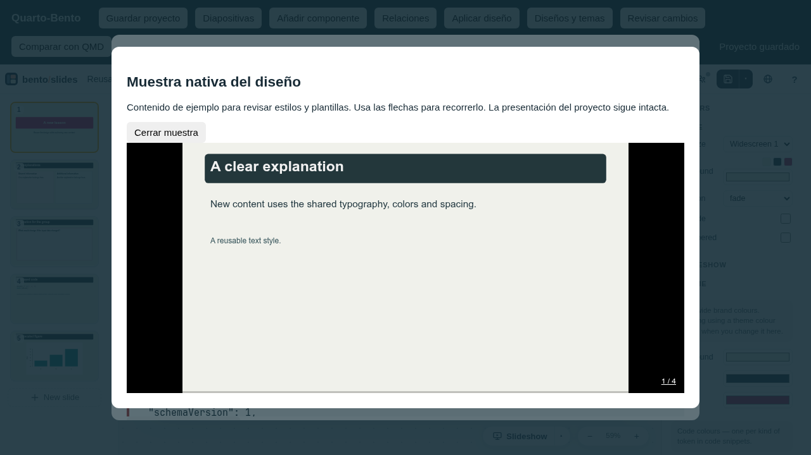
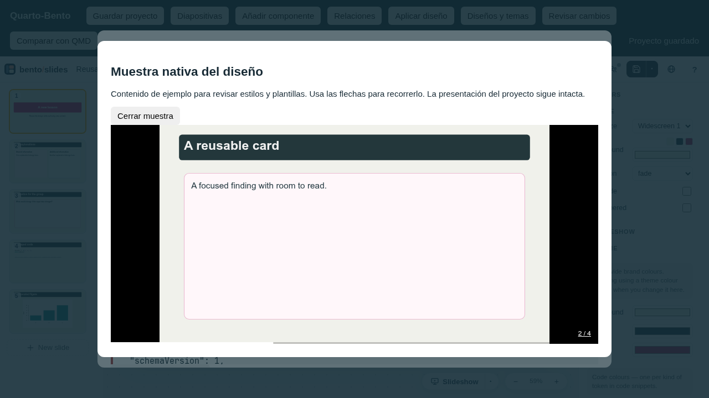
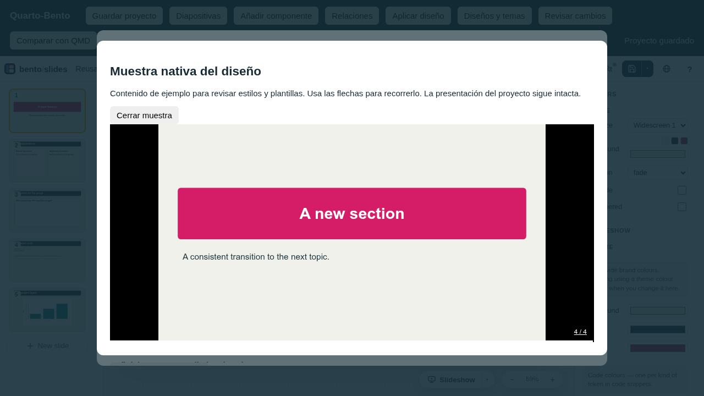

# Reusable designs: integrated Linux receipt

Validated locally on 2026-10-18. Runtime integration is `0d6d424`; `6317ce9`
updates the dependency injection in existing Studio client test harnesses. The
Bento shell and schema remain pinned at
`3d6f7f1fcdf2308e875345ce4f1e0ec0820c914b` (Bento 1.2.6). This is a
current-source feature after published npm 0.1.1. No npm publication, global
installation update, stable-v1 or other-platform acceptance is claimed.

## Environment and focused acceptance

Linux, Deno 2.9.7, Quarto 1.10.19, R 4.6.1 and installed Chromium 154.0.8037.97.
The final feature run passed **45 tests, zero failures**:

```sh
deno test --allow-read --allow-write --allow-env --allow-run \
  --allow-net=127.0.0.1 \
  tests/design_package_test.ts tests/design_initialize_test.ts \
  tests/design_adaptation_test.ts tests/design_studio_client_test.ts \
  tests/studio_registry_client_test.ts tests/reusable_design_test.ts \
  tests/reusable_design_execution_test.ts tests/design_registry_read_test.ts \
  tests/design_workflow_test.ts
```

The six existing Studio harness files separately passed **11 tests, zero
failures** after injecting the newly imported design modules. Existing source
review, deletion confirmation, selection, stale-preview, diagnostics and delayed
Apply assertions were retained. The harness correction changes no runtime code.

Source type checking, lint (232 files), source/test/script formatting (229
files) and Git whitespace checks passed. Repository-wide formatting also reports
pre-existing Markdown/SVG/JSON formatting differences; historical receipts were
not reformatted to hide those differences.

## Behavioral evidence

- Two real Quarto projects initialized from the same package retain independent
  document identities. The new-directory initializer records a source binding,
  uses exclusive directory creation/no-clobber publication and leaves a recovery
  marker on interrupted publication. It refuses existing state, output, unsafe
  paths and conflicting source selectors.
- Updating an imported design preserves pending authored text, a moved text
  object and an individually recolored native decoration. Subsequent changed R
  input regenerates a different figure while preserving identity and design.
- Export excludes lesson content, document identity, state, pending edits and
  object geometry. It reads newly saved registry defaults before recalculation
  and combines them only with actual saved native document-theme overrides.
- Import previews the complete registry replacement and removed definitions.
  Apply checks document/revision, original source hash, package and exact
  registry bytes; source is checked again under the registry transaction lock
  and during publication. State, output and QMD remain unchanged by import.
- Original source style, slide-variant and layout references are checked before
  accepting an incompatible design or executing Quarto. A decorated default
  template on unsupported content before the first slide heading refuses before
  its R producer runs.
- Theme decorations retain checked design-only provenance. Deleting one cannot
  produce a proposal to delete its source slide heading.
- Studio uses the same checked package operations as the CLI, refuses unsaved
  registry drafts, preserves advanced fields in basic form edits, and binds
  previews to saved state. An isolated native sample uses neutral content. If
  that fixed sample does not fit a valid design's compact frame, the checked
  import plan remains reviewable with a sample warning.

## Real browser and local course reference

Playwright CLI drove the real shipped Studio and pinned Bento shell in headless
Chromium at 1280 × 720. The browser selected a local package, reviewed its
replacement, opened the native sample, navigated through
content/card/code/section slides, closed it, explicitly applied the package and
recalculated. The QMD SHA-256 stayed unchanged; the demonstration retained its
document identity and zero pending changes. The preview remains inside a bounded
Studio dialog with a visible close button; fullscreen is disabled for that
sample.







The same browser prepared a draft from the owner's rendered session 01 using
`examples/reusable-designs/spp-reference.mapping.json`. Attempting to replace
the richer example with this smaller sampled vocabulary correctly refused
`UNKNOWN_STYLE: section-subtitle`, rather than installing missing definitions.
The complete course example package supplies those additional reviewed styles
and layouts. Browser console observations include the existing blocked upstream
update/favicons and denied sample fullscreen; this is not a claim of a
zero-message browser console or foreground desktop qualification.

The actual reference was read-only. Its SHA-256 was
`d515c3c805514a6acc5c34043a34a6606ea3b93564bf651aa250f591a0d6bf39`. The
[sampling report](reusable-designs-linux/reference-sampling-report.json) records
10 explicit samples, three decoded embedded Quarto CSS links, 19 excluded
scripts and no excluded external stylesheets. Selected properties include 32 px
body text, 45.76 px content headings, 54.4 px centered section headings, dark
title bars, magenta section bars and pink/teal card fills and borders. Root
HTML/body classes, theme attributes and inline styles retain their sanitized
matching/inheritance behavior.

Reference scripts, event handlers and external requests never run in the
sampler. Tests count zero requests to a local server despite malicious scripts,
images, linked CSS, CSS imports and background URLs. The fresh browser applies
its restrictive CSP and URL block before adopting inert sanitized content.
Malformed embedded CSS, non-UTF8 data, missing/ambiguous selectors and unsafe
local files refuse explicitly.

Fira Sans was embedded in the reference but is unavailable on this host. The
explicit mapping fallback keeps `Fira Sans, Arial, sans-serif`; no font was
installed or included in the package. These checks establish bounded native
style adaptation, not pixel-identical Reveal rendering, arbitrary CSS/layout
conversion, figure recoloring or course-content migration. The course checkout
remained clean. Session 02 teaching content was not authored by this feature.

## Portable reconstruction

The current-runtime helper passed using **124 portable payload files**:

```sh
deno run --no-config --no-remote --no-npm --allow-read --allow-write \
  --allow-run --allow-env scripts/reusable-design-check.ts
```

It stages and relocates the application into a path with spaces, uses fresh
Deno/Quarto caches and `QUARTO_RUN_NO_NETWORK=true`, initializes a new themed
QMD, renders, exports, previews/applies, relocates the presentation, deletes its
HTML/build output and rebuilds with the same identity. It also adapts local
inline CSS with installed Chromium. QMD remains byte-identical. See the
[portable receipt](reusable-designs-linux/portable-receipt.json).

The historical `scripts/portable-check.ts` requires Deno 2.9.6 and refused this
2.9.7 host before its smoke run. Its guard was retained; the current-runtime
helper above provides separate new-feature evidence. No dependency manager,
runtime installation or global npm/mise change was introduced.

## Broad regression run

The broad local run enabled Studio, relation/layout browser and real Python
execution tests with `DENO_JOBS=2` and loopback-only network permission. It
finished with **634 passed tests and four steps, ten failures and one ignored
test** in 26 minutes. All ten failures were the same missing
`attachReusableDesigns` import injection in six existing client harnesses. After
the correction at `6317ce9`, all eleven cases in those files passed, including
the ten failed cases. The final 45-test feature run also includes two adaptation
regressions added after the broad run began.

These are combined passing results after a targeted correction, not a new single
clean full-suite run on the final commit. No runtime assertion was weakened. The
strict real-widget SVG comparison passed; its historical intermittent mismatch
remains unexplained. The optional pinned upstream source comparison was omitted
because `QBENTO_BENTO_SOURCE` was unset; vendored pinned bytes were not changed.

Local detailed logs are under `output/reusable-designs/`:
`acceptance-tests.log`, `studio-regressions.log`, `full-tests.log`,
`final-typecheck.log`, `final-lint.log`, `final-code-format.log`,
`final-portable-design-check.log` and the browser snapshots. These local
artifacts are excluded from Git; the scoped receipt, screenshots and selected
JSON reports above are committed.

## Subsequent review corrections (2026-10-18)

Two additional regressions were reproduced after the integrated receipt above:

- A package could change a style used by an authored paragraph wrapper from
  `text` to `code`. Preview and Apply accepted the incompatible registry; the
  next render executed R before refusing `STYLE_TARGET_MISMATCH`. Source
  preflight now follows a single authored object through plain/nested wrappers
  and checks its text/code target before import or execution. Computed and
  unsupported shapes still require the executed projection's existing checks.
- Heading defaults were applied after a named wrapper style, overwriting its
  font size, color and weight. Heading base values now enter the same cascade
  before card typography, role defaults and named styles. Explicit QMD fields
  still take precedence. The correction covers headings inside and outside
  cards and retains ordinary heading defaults.

Three new regression tests failed against the reviewed source before these
corrections and passed afterward. They cover authored paragraphs, headings,
lists and displayed code through plain/nested wrappers, real Quarto heading
projection, rejected Preview/Apply with byte-identical QMD/registry/state/HTML,
and a manually incompatible registry refusing before an R filesystem marker
can be created. These are additional checks, not a revision of the historical
45-test and broad-suite results above.

The subsequent related regression run passed **94 tests, zero failures** in
4 minutes 1 second on Linux with Deno 2.9.7 and Quarto 1.10.19:

```sh
deno test --allow-read --allow-write --allow-env --allow-run \
  --allow-net=127.0.0.1 \
  tests/design_package_test.ts tests/design_initialize_test.ts \
  tests/design_adaptation_test.ts tests/design_studio_client_test.ts \
  tests/studio_registry_client_test.ts tests/reusable_design_test.ts \
  tests/reusable_design_execution_test.ts tests/design_registry_read_test.ts \
  tests/design_workflow_test.ts tests/studio_client_diagnostics_test.ts \
  tests/studio_element_deletion_client_test.ts tests/studio_graph_preview_test.ts \
  tests/studio_sync_busy_test.ts tests/studio_sync_review_test.ts \
  tests/studio_sync_selection_test.ts tests/design_test.ts \
  tests/design_execution_test.ts tests/components_execution_test.ts \
  tests/registry_test.ts tests/registry_execution_test.ts \
  tests/displayed_code_test.ts tests/computed_code_test.ts \
  tests/computed_code_execution_test.ts
```

`deno task check`, `deno lint src tests scripts`, source/script and changed-test
formatting, and Git whitespace checks also passed. This is a targeted regression
run, not a new full-suite, foreground visual, portable or publication receipt.
